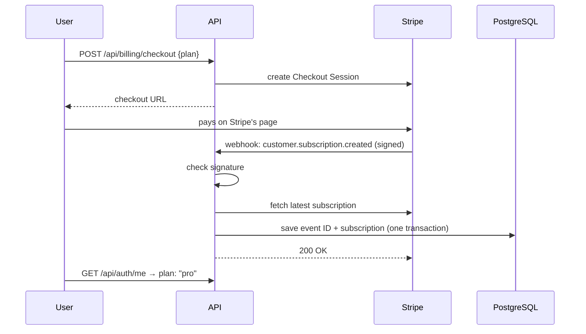

# Stripe Subscriptions

[](https://github.com/haniyaiqbal/stripe-subscriptions/actions/workflows/ci.yml)

The billing backend of a small SaaS, built with **NestJS, PostgreSQL and Stripe**.

Users start on a **Free** plan, upgrade to **Pro** (monthly or yearly) through Stripe Checkout, and their access switches on automatically when Stripe confirms the payment. They can cancel, resume, or manage their card in Stripe's billing portal. Admins get a view of all users and monthly revenue.

## Features

- **Free and Pro plans**: Free users get 3 projects; Pro users get unlimited projects and CSV export
- **Stripe Checkout** for payment: card details never touch this server
- **Webhooks** that keep each user's plan in sync with Stripe, with signature checks and protection against duplicate events
- **Cancel at period end** (users keep what they paid for) and **resume** before it ends
- **Stripe billing portal** for changing card, switching plan and downloading invoices
- **Roles**: users and admins. Admins see all users, subscription statuses and monthly recurring revenue
- **Deny by default**: every route must say who can call it, or nobody can
- JWT login, rate limiting, Swagger docs at `/docs`, health checks

## How a payment flows



The user's plan is never changed by the browser saying "I paid". It only changes when **Stripe** tells us, through a signed webhook.

## Design decisions

These are the parts worth talking about, and why I built them this way.

| Decision | Why |
|---|---|
| **Webhooks decide the plan, not the success page** | Anyone can open `/billing/success`. Only Stripe can send a correctly signed webhook. |
| **Signature checked on the raw body** | Stripe signs the exact bytes it sent. Re-serialising the parsed JSON could change the bytes and break the check, so the app keeps the raw body (`rawBody: true`). |
| **Each event is processed once** | Stripe can deliver the same event more than once. Every event ID is saved in a `stripe_events` table **in the same transaction** as the change it causes. A repeat finds the ID and does nothing. The primary key makes this safe even when two copies arrive at the same moment. |
| **Fetch the latest subscription instead of trusting the event** | Stripe doesn't guarantee event order. An old "active" event could arrive after a newer "canceled" one. Fetching the current subscription from Stripe means the order doesn't matter. |
| **If processing fails, the event isn't marked as done** | The transaction rolls back, we return an error, and Stripe retries later (for up to 3 days). |
| **Idempotency keys on calls to Stripe** | Creating a customer uses the key `customer:<userId>`, so a retry can't create a second customer. Checkout accepts an optional `Idempotency-Key` header and passes it on (scoped to the user). |
| **`past_due` still counts as Pro** | While Stripe retries a failed card, cutting the user off would be harsh. If all retries fail, Stripe ends the subscription and the user drops to Free. |
| **Cancel means "at the end of the period"** | The user paid for the month, so they keep Pro until it ends. They can change their mind with `/resume`. |
| **Prices are found by lookup key** | The code refers to `pro_monthly` / `pro_yearly`, not Stripe price IDs, so the same code works in test and live mode. |
| **Deny by default** | With `@nestjs/authorization`, a route without a rule is blocked. Forgetting a check fails closed instead of open. |
| **Stripe errors become a clear 502** | If Stripe is down or rejects a call, the user gets "payment provider error", and Stripe's details go to the logs only. |
| **CSV export escapes formulas** | A project named `=SUM(...)` would run as a formula in Excel. Cells starting with `=`, `+`, `-` or `@` are prefixed so they show as text. |

## Tech stack

| Part | Tools |
|---|---|
| API | NestJS 12, TypeScript (ESM), Zod validation |
| Payments | Stripe (Checkout, Billing Portal, webhooks), Stripe Node SDK |
| Database | PostgreSQL 17, TypeORM with migrations |
| Auth | `@nestjs/authentication` (JWT, scrypt), `@nestjs/authorization` (policies) |
| Docs and health | Swagger (OpenAPI), `@nestjs/terminus` |
| Testing | Vitest (unit and end-to-end), Supertest, a fake Stripe |
| DevOps | Docker, Docker Compose, GitHub Actions |

## Run it

You need **Docker**, a free **Stripe account** (test mode) and the **[Stripe CLI](https://docs.stripe.com/stripe-cli)**.

```bash
cp .env.example .env
# Put your Stripe test secret key (sk_test_...) in .env

npm install
npm run stripe:setup        # creates the Pro product and prices in your Stripe test account

stripe login
npm run stripe:listen       # forwards Stripe webhooks to your machine
# Copy the "whsec_..." secret it prints into STRIPE_WEBHOOK_SECRET in .env

docker compose up --build   # starts Postgres and the API on http://localhost:3000
```

Open **http://localhost:3000/docs** to try every endpoint in the browser.

To pay in test mode, use the card `4242 4242 4242 4242`, any future expiry date and any CVC.

### Try the whole flow

```bash
# 1. Sign up (use an email from ADMIN_EMAILS to be an admin)
TOKEN=$(curl -s -X POST localhost:3000/api/auth/sign-up \
  -H 'Content-Type: application/json' \
  -d '{"email":"me@example.com","password":"a-long-password"}' | jq -r .accessToken)

# 2. Start a checkout and open the URL it returns
curl -X POST localhost:3000/api/billing/checkout \
  -H "Authorization: Bearer $TOKEN" -H 'Content-Type: application/json' \
  -d '{"plan":"pro_monthly"}'

# 3. After paying, you're Pro
curl localhost:3000/api/auth/me -H "Authorization: Bearer $TOKEN"
```

## API

| Method | Path | Who | What it does |
|---|---|---|---|
| `POST` | `/api/auth/sign-up` | anyone | Create an account |
| `POST` | `/api/auth/sign-in` | anyone | Sign in |
| `GET` | `/api/auth/me` | signed in | Your profile, role and plan |
| `GET` | `/api/billing/plans` | anyone | Plans and prices |
| `POST` | `/api/billing/checkout` | signed in | Get a Stripe Checkout URL for a plan |
| `GET` | `/api/billing/subscription` | signed in | Your current subscription |
| `POST` | `/api/billing/cancel` | signed in | Cancel at the end of the period |
| `POST` | `/api/billing/resume` | signed in | Undo a cancel |
| `POST` | `/api/billing/portal` | signed in | Get a Stripe billing portal URL |
| `GET` | `/api/projects` | signed in | Your projects |
| `POST` | `/api/projects` | signed in | Create a project (Free: max 3) |
| `GET` | `/api/projects/export` | **Pro** | Download projects as CSV |
| `DELETE` | `/api/projects/:id` | signed in | Delete a project |
| `GET` | `/api/admin/users` | **admin** | All users with their plans |
| `GET` | `/api/admin/stats` | **admin** | User count, Pro subscribers, MRR |
| `POST` | `/api/webhooks/stripe` | Stripe | Receives Stripe events |

## Tests

```bash
npm test            # unit tests
npm run test:e2e    # end-to-end tests (needs: docker compose up -d postgres)
```

The end-to-end tests run the real app and database, with a **fake Stripe** in place of the network calls, so they need no Stripe account. Webhooks are still signed and checked with Stripe's real code. They cover:

- Free limits (3 projects, no export) and the upgrade to Pro when the webhook arrives
- Webhooks with a wrong or missing signature are rejected
- The same event sent twice is only processed once
- An old event arriving late doesn't undo a newer change
- Cancel and resume, dropping back to Free when the subscription ends
- A second checkout is refused while already on Pro
- Admin routes return 403 for normal users and 401 for guests

Rate limits are switched off when `NODE_ENV=test`, because the tests sign up many users in a few seconds.

## Project structure

```
src/
  auth/       sign-up, sign-in, JWT provider
  users/      user entity (role, Stripe customer)
  billing/    plans, Stripe wrapper, checkout, webhooks, subscription sync
  projects/   the Free/Pro gated feature, with its policy
  admin/      admin-only users list and revenue stats
  database/   data source and migrations
scripts/      stripe-setup: creates the product and prices
test/         end-to-end tests and the fake Stripe
```

## License

MIT
